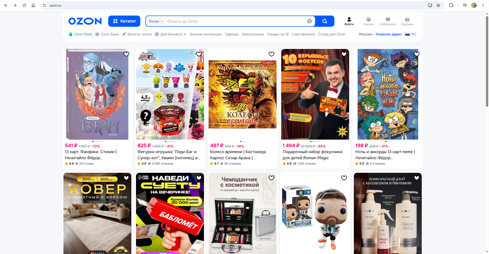
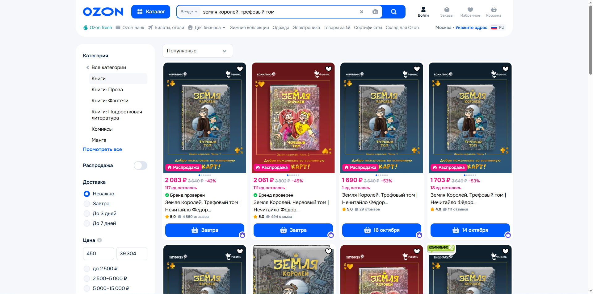
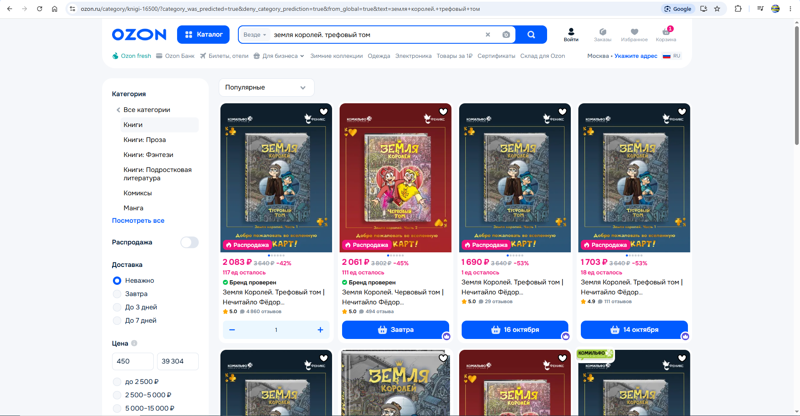
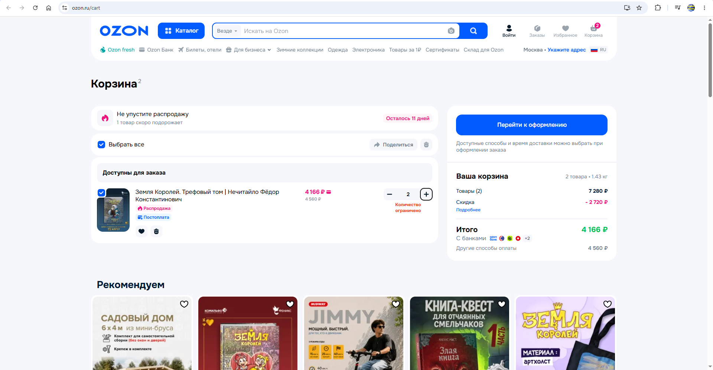
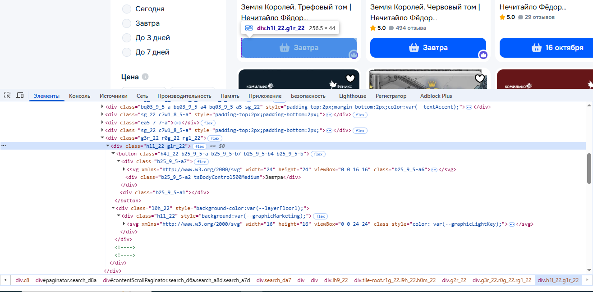
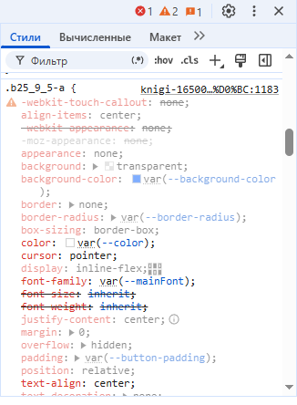
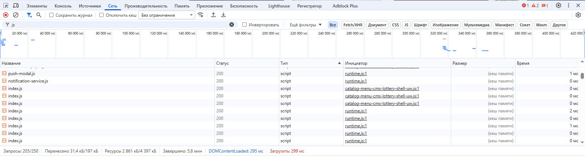
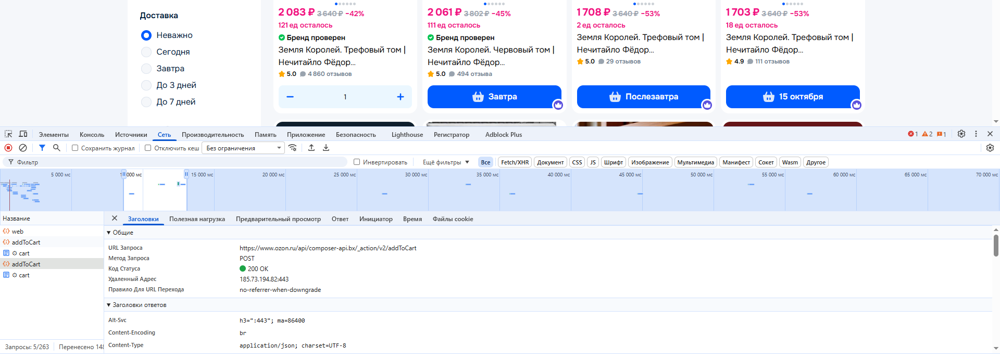

# tilda_computer-science_part1
Лабораторная работа №1

# Анализ информационной системы
## 1. Описание системы

Название: Ozon

Ссылка: https://www.ozon.ru/

Назначение: Ozon — онлайн-площадка, предназначенная для покупки и продажи товаров и отслеживания их местоположения. 

Целевая аудитория:
- Частные пользователи, приобретающие товары для себя или других.
- Предприниматели и владельцы малого бизнеса.
- Компании, выставляющие свой ассортимент товаров для лучшего их распространения.
- Доставщики и работники пунктов выдачи заказов, выполняющие роль посредников между продавцом и покупателем.

Основные возможности:
- Выбор товара из огромного ассортимента.
- Поиск товара по определённой категории или названию.
- Добавление своих товаров на сайт.
- Выбор удобного способа доставки и пункта выдачи. заказа.

Выбранный сценарий: Поиск товара и добавление в корзину.
В рамках сценария пользователь запрашивает необходимый товар, изучает результаты поиска, добавляет подходящий товар в корзину и проверяет результат.

## 2. Анализ пользовательского интерфейса

### 2.1. Основные страницы и разделы

В рамках лабораторной работы исследуется информационная система Ozon — интернет-магазин.

В системе используются следующие основные страницы:
- Главная страница Ozon.
- Результаты поиска.
- Корзина.

Оформление заказа доступно только после авторизации пользователя.

### 2.2. Ключевые элементы интерфейса

|   Элемент интерфейса   |                                 Назначение                                |
|:----------------------:|:-------------------------------------------------------------------------:|
| Логотип Ozon           | Переход на главную страницу сайта                                         |
| Главная страница       | Навигация между основными разделами системы                               |
| Строка поиска          | Ввод текстового запроса для системы                                       |
| Каталог товаров        | Определение категории и типа искомого товара                              |
| Личный кабинет         | Предоставление доступа к функциям, закрытым для обычного посетителя сайта |
| Заказы                 | Выбор способа доставки и оплаты                                           |
| Избранное              | Просмотр отмеченных товаров                                               |
| Корзина                | Просмотр запланированных к заказу товаров                                 |
| Витрина товара         | Предоставление общей информации о товаре при поиске                       |
| Настройки товара       | Увеличение количества товара в корзине                                    |
| Значок пересылки       | Предоставление доступа к просмотру корзины другому пользователю           |
| Значок мусорного ведра | Очистка корзины пользователя                                              |

### 2.3. Выполнение пользовательского сценария

Выбранный сценарий: Поиск товара и добавление в корзину в интернет-магазине Ozon.

В качестве товара использовался комикс «Земля Королей. Трефовый том» за авторством Нечитайло Фёдора Константиновича.

Последовательность действий:
1. Открыть сайт Ozon
2. Ввести название необходимого товара в строку поиска
3. Выбрать наиболее подходящий товар и добавить его в корзину.
4. Проверить, что товар добавился в корзину пользователя.
5. При необходимости увеличить количество товара.

В результате выполнения сценария товар был добавлен в корзину в количестве двух штук.

### 2.4. Компоненты, участвующие в сценарии

| Компонент интерфейса |                        Назначение                       | Этап сценария |
|:--------------------:|:-------------------------------------------------------:|:-------------:|
| Строка поиска        | Позволяет пользователю найти необходимый товар          | 2             |
| Витрина товара       | Показывает внешний вид, цену и дату доставки товара     | 3             |
| Корзина              | Показывает пользователю запланированные к заказу товары | 4             |
| Настройки товара     | Позволяет увеличить количество заказываемого товара     | 4             |

### 2.5. Скриншоты

#### Скриншот 1. Главная страница Ozon

На скриншоте показан пример главной страницы, содержание которой зависит от рекомендаций.

#### Скриншот 2. Результаты поиска

На скриншоте показаны результаты поиска по запросу «Земля Королей. Трефовый том» до добавления товара в корзину.

#### Скриншот 3. Добавление в корзину

На скриншоте показан вид витрины товара после добавления товара в корзину.

#### Скриншот 4. Просмотр содержимого корзины

На скриншоте показан результат выполнения сценария – товар добавлен в корзину в количестве двух штук.

### 2.6. Вывод

В ходе анализа пользовательского интерфейса Ozon были определены основные страницы системы, ключевые элементы управления и изменяемые параметры сайта.

Выбранный сценарий состоит из следующих основных этапов:
- поиск по названию товара;
- выбор подходящего товара
- добавление товара в корзину;
- увеличение количества товара в корзине;
- проверка результата.

Пользовательский интерфейс Ozon построен вокруг каталога рекомендаций и целенаправленного поиска по названию, которые позволяют найти необходимый товар из множества категорий или какой-то конкретной. Для выполнения сценария пользователю не требуется писать код.

## 3. Анализ клиентской части сервиса

### 3.1. Исследование HTML-структуры

Для анализа был выбран элемент «Добавить в корзину» в интернет-магазине Ozon.

Элемент используется для переноса товаров в общее место для дальнейшего оформления заказа.

Основные характеристики элемента:
- HTML-тег: `
Завтра
`
- CSS-классы: `b25_9_5-a2 tsBodyControl500Medium`, отвечающие за оформление и поведение элемента
- Текст элемента: «Завтра»
- Вложенные элементы: текст "Завтра" и иконки в формате svg

Скриншот HTML-структуры:

### 3.2. Исследование CSS-структуры

Для выбранного элемента были обнаружены CSS-классы, определяющие его внешний вид и положение на странице.

Основные свойства:

|    Свойство   |                     Назначение                    |
|:-------------:|:-------------------------------------------------:|
| `display`     | Определяет способ отображения элемента            |
| `padding`     | Задаёт внутренние отступы                         |
| `align-items` | Задаёт выравнивание одних элементов внутри других |
| `height`      | Определяет высоту элементов                       |
| `background`  | Определяет фон элемента                           |
| `margin`      | Задаёт внешние отступы                            |
| `color`       | Определяет цвет текста                            |
| `cursor`      | Определяет вид курсора при наведении на элемент   |

Скриншот CSS-стилей:

### 3.3. Исследование JavaScript

JavaScript используется для реализации взаимодействия с интернет-магазином.

В разделе **Источники** были обнаружены JavaScript-файлы, загружаемые вместе со страницей.

JavaScript отвечает за:
- обработку нажатий пользователя;
- открытие и закрытие элементов интерфейса;
- изменение содержимого страницы;
- взаимодействие с сервером;
- обновление интерфейса без полной перезагрузки страницы.

При нажатии на кнопку добавления товара в корзину интерфейс на действие пользователя и просит его указать количество товара в штуках.

Скриншот загруженных JavaScript-файлов:

### 3.4. Загружаемые ресурсы

При открытии интернет-магазина браузер загружает различные ресурсы, необходимые для работы приложения.

Были обнаружены следующие типы ресурсов:
|     Тип    |         Пример        | Назначение                            |
|:----------:|:---------------------:|---------------------------------------|
| document   | HTML-страница         | Загрузка страницы                     |
| fetch      | Запросы к серверу     | Обмен данными                         |
| font       | Шрифты                | Отображение текста                    |
| ping       | Запросы к серверу     | Задержка между браузером и сервером   |
| png        | Фотографии            | Формат загруженных файлов             |
| script     | JavaScript-файлы      | Работа клиентской логики              |
| stylesheet | CSS-файлы             | Оформление интерфейса                 |
| text/html  | Веб-страница          | Обозначение HTML-кода                 |
| text/plain | Электронные письма    | Обозначение текста без форматирования |
| webp       | Изображения на сайтах | Оптимизация размера файлов            |

### 3.5. Анализ сетевых запросов

При открытии интернет-магазина браузер выполняет большое количество сетевых запросов.

Они используются для загрузки интерфейса, JavaScript, CSS, изображений и обмена данными с сервером.

Примеры обнаруженных запросов:
|                                  Метод                                  |     Тип    | Статус | Назначение                          |
|:-----------------------------------------------------------------------:|:----------:|--------|-------------------------------------|
| GET /s3/cms/81/t48/wc200/logo_ozon_1.png                                | fetch      | 200    | Запрос к серверу                    |
| POST /perf-metrics-collector/v4/rum/bx/web                              | ping       | 200    | Задержка между браузером и сервером |
| GET /s3/shared-deps/%40bx-fe/common-feature-atom-actions/1.4.8/index.js | script     | 200    | Загрузка JavaScript                 |
| GET /s3/shared-deps/%40bx-fe/ui-kit-image/5.4.3/index.css               | stylesheet | 304    | Загрузка CSS                        |

### 3.6. Запрос при добавлении в корзину

При выполнении сценария «Поиск товара и добавление в корзину» в разделе **Сеть** были обнаружены дополнительные запросы.

Один из запросов был связан с получением или передачей данных, необходимых для работы интернет-магазина.

Основные параметры:
- Метод: `POST`;
- URL: `/api/composer-api.bx/_action/v2/addToCart`;
- Тип: `fetch`;
- Статус: `200 OK`;
- Данные запроса: идентификаторы категории и товара из результатов поиска;
- Ответ: данные, необходимые клиентской части для отображения товара в корзине (HTML).

Скриншот запроса:

### 3.7. Вывод

В ходе анализа клиентской части Ozon были изучены:
- HTML-структура элемента интерфейса;
- CSS-классы и основные стили;
- JavaScript-файлы и их роль в работе интерфейса;
- загружаемые ресурсы;
- сетевые запросы браузера.

Было установлено, что клиентская часть отвечает за отображение витрины товара, обработку действий пользователя и взаимодействие с сервером.

При добавлении товара в корзину пользователь выполняет действие в интерфейсе, JavaScript обрабатывает это действие, а клиентская часть при необходимости выполняет сетевые запросы для получения или передачи данных.

## 4. Анализ серверной части и API

### 4.1. Серверная часть
Серверная часть Ozon отвечает за операции, которые требуют обработки и хранения данных на сервере.

В рамках выбранного сценария «Поиск товара и добавление в корзину» можно предположить существование таких серверных операций:
- получение данных о категории искомого товара;
- получение данных о товарах на странице;
- сохранение изменений страницы;
- загрузка и получение необходимых ресурсов.

Точная внутренняя реализация серверной части недоступна пользователю, поэтому часть выводов основана на наблюдаемых сетевых запросах и поведении системы.

### 4.2. Передаваемые данные

При работе интернет-магазина между браузером и сервером передаются различные данные. В зависимости от выполняемого действия это могут быть:
- идентификатор категории товара;
- идентификатор определённого товара;
- информация о товаре для витрины;
- количество добавленного в корзину товара;
- данные пользователя;
- данные для сохранения изменений.

При добавлении товара в корзину клиентская часть должна передать серверу информацию, необходимую для определения категории, товара и выполняемого действия. Часть этих данных может передаваться в URL, заголовках или теле HTTP-запроса.

### 4.3. API и сетевое взаимодействие

В разделе **Сеть** были обнаружены запросы типа fetch. Они используются клиентской частью для обмена данных с сервером.

Пример наблюдаемого запроса:
- Метод: POST;
- URL: /api/composer-api.bx/_action/v2/addToCart;
- Тип: fetch;
- Статус: 200 OK;
- Назначение: передача данных между интернет-магазином и сервером;
- Данные: идентификатор категории, идентификатор товара.

API позволяет клиентской части отправлять данные на сервер и получать результат обработки.

Пример сетевого запроса:

### 4.4. Внешние сервисы

При работе Ozon браузер может обращаться не только к основному домену системы, но и к другим доменам. Такие обращения могут использоваться для:
- загрузки шрифтов;
- загрузки изображений;
- аналитики
- работы внешних интеграций;
- других дополнительных функций.

В ходе анализа были обнаружены следующие внешние домены:

### 4.5. Хранилища данных

Внутренние хранилища непосредственно из браузера не видны, однако на основе внешнего анализа по функциям системы можно предположить наличие нескольких типов хранилищ:
### 4.6. Общая схема взаимодействия

На основании проведённого анализа можно представить упрощённую схему работы информационной системы:

## 5. Описание пользовательского сценария
### 5.1. Выбранный сценарий

Название сценария: поиск товара и добавление в корзину в интернет-магазине Ozon.

Цель сценария: добавить один товар из результатов поиска в корзину.

### 5.2. Последовательность выполнения сценария

#### Этап 1. Пользователь открывает сайт

Пользователь заходит на Ozon, вводит запрос в строку поиска.

На этом этапе браузер загружает необходимые HTML-, CSS- и JavaScript-ресурсы.

#### Этап 2. Пользователь изучает результаты поиска
Пользователь начинает искать подходящий товар из множества других.

JavaScript обрабатывает действие пользователя и открывает результаты поиска с витринами товаров.

#### Этап 3. Пользователь добавляет товар в корзину
Пользователь находит подходящий товар и добавляет его в корзину.

Клиентская часть определяет выбранный пользователем товар и подготавливает данные для его переноса в корзину.

#### Этап 4. Клиентская часть взаимодействует с сервером
При необходимости браузер отправляет запрос на сервер через API.

В запросе могут передаваться данные о товаре, категории товара и выполняемом действии.

#### Этап 5. Сервер обрабатывает запрос
Сервер принимает запрос и выполняет необходимые операции.

Предположительно, сервер проверяет наличие у пользователя подключения. Если требуется сохранение изменений, данные записываются в соответствующее хранилище.

#### Этап 6. Сервер возвращает результат
После обработки сервер возвращает результат клиентской части.

Клиент получает необходимые данные и продолжает работу в интернет-магазине.

#### Этап 7. Интерфейс отображает результат
JavaScript обрабатывает полученный результат и обновляет интерфейс. Выбранный товар был перемещён в корзину. 

Пользователь видит результат своего действия.
### 5.3. Общая последовательность

Упрощённо сценарий можно представить следующим образом:

## 6. Построение архитектурной схемы
### 6.1. Архитектурная схема
### 6.2. Взаимодействие компонентов
